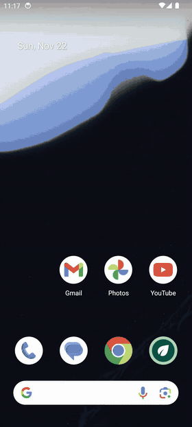
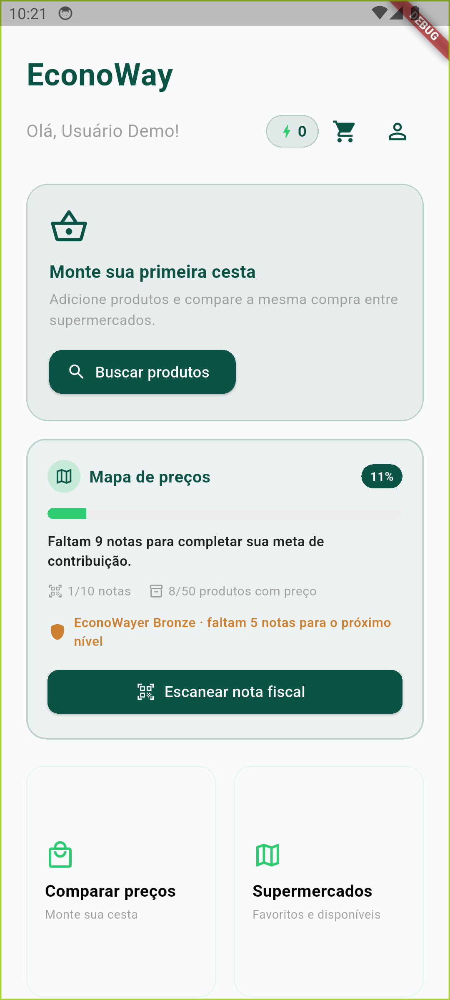
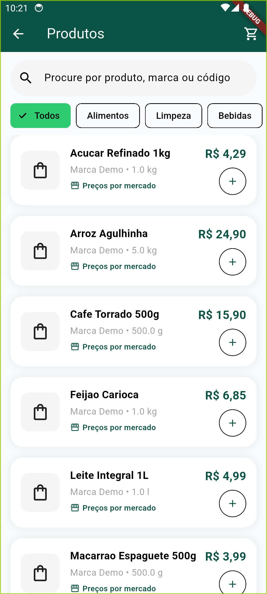
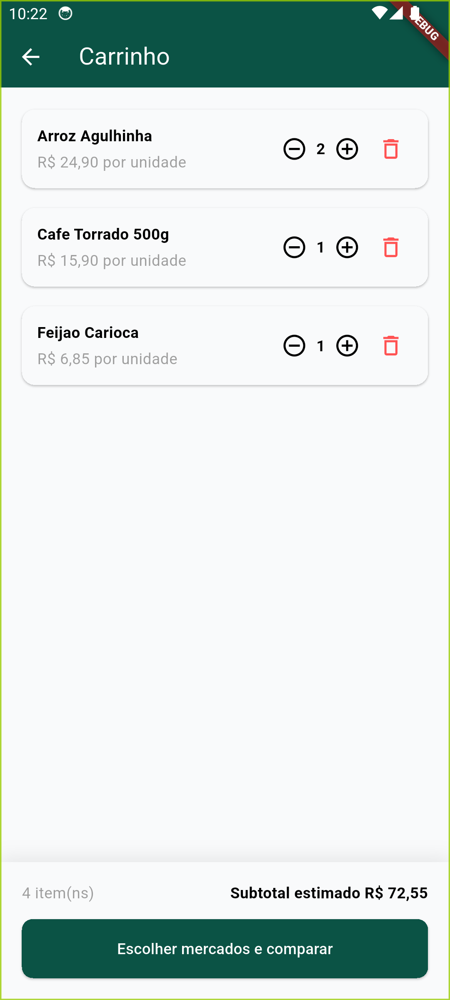
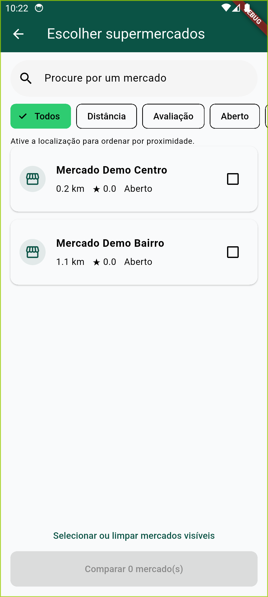
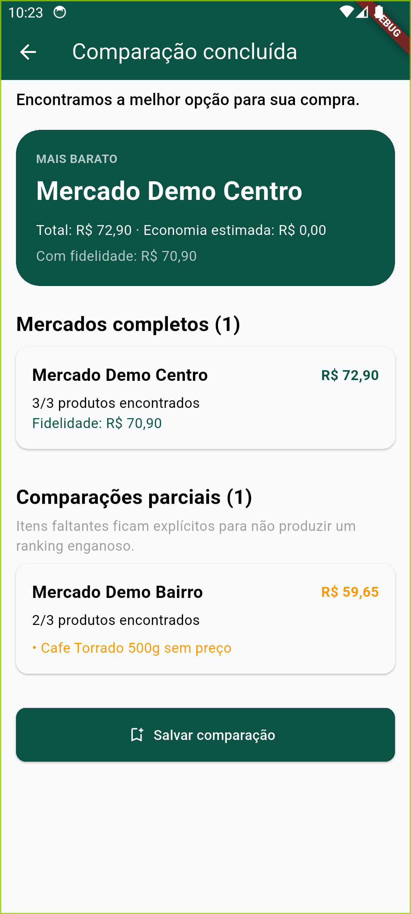
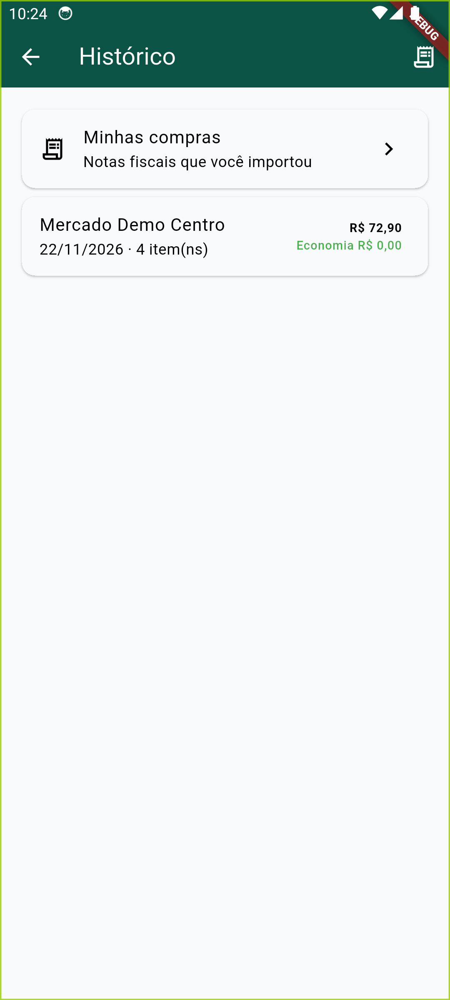
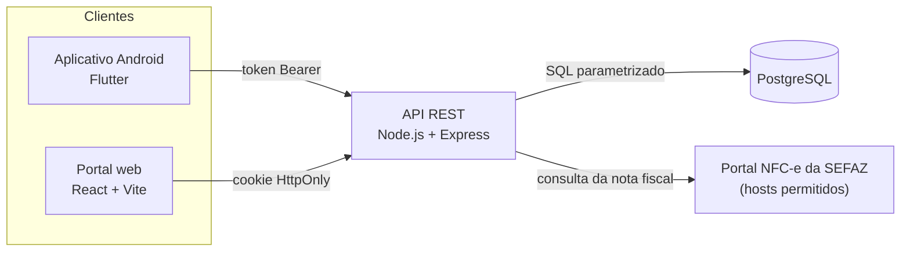

<div align="center">


# EconoWay

**Compare a mesma cesta de compras em vários supermercados e descubra onde ela sai mais barata.**

Projeto Integrador · Análise e Desenvolvimento de Sistemas · Centro Universitário Senac · 2026

[](https://github.com/JayneSoraya/ProjetoIntegradorSenac/actions/workflows/ci.yml)
[](https://github.com/JayneSoraya/ProjetoIntegradorSenac/actions/workflows/codeql.yml)


[Demonstração](#demonstração) · [Funcionalidades](#funcionalidades) · [Arquitetura](#tecnologias-e-arquitetura) · [Como executar](#como-executar) · [Documentação](#documentação)

</div>

---

## Demonstração

<table>
  <tr>
    <td width="300" valign="top">
      
    </td>
    <td valign="top">

**Fluxo gravado no aplicativo real**, executado em emulador Android e conectado à API e ao banco locais:

1. Login com conta de demonstração
2. Busca de produtos e escolha das quantidades
3. Carrinho salvo no servidor
4. Seleção dos supermercados
5. Comparação da cesta e economia estimada
6. Comparação salva no histórico

**[Assistir ao vídeo completo (54 s, sem áudio)](docs/entrega/econoway-demo.mp4)**

A prévia ao lado está acelerada. Os produtos e mercados exibidos são dados de demonstração.

</td>
  </tr>
</table>

<details>
<summary><b>Telas do aplicativo</b> (capturas do emulador, build de depuração)</summary>
<br>

<table>
  <tr>
    <td align="center"><br><sub>Início</sub></td>
    <td align="center"><br><sub>Produtos</sub></td>
    <td align="center"><br><sub>Carrinho</sub></td>
  </tr>
  <tr>
    <td align="center"><br><sub>Supermercados</sub></td>
    <td align="center"><br><sub>Comparação</sub></td>
    <td align="center"><br><sub>Histórico</sub></td>
  </tr>
</table>

Na captura da comparação, só um mercado tem todos os itens: por isso a economia aparece como R$ 0,00 e o outro mercado é mostrado como comparação parcial, com o item faltante indicado. No vídeo, com dois mercados completos, a economia estimada é calculada normalmente.

</details>

---

## O problema

Quem faz compras de mercado costuma comparar preços produto por produto, em panfletos, aplicativos e sites diferentes. Isso toma tempo e engana: o mercado mais barato para um item nem sempre é o mais barato para a compra inteira, e um mercado que não tem todos os produtos pode parecer mais barato só porque está faltando algo na conta.

O EconoWay compara **a cesta completa** e deixa claro quando um mercado não tem todos os itens.

## Funcionalidades

### Implementadas nesta prova de conceito

**Aplicativo Android (consumidor)**

- cadastro, login e sessão guardada em armazenamento seguro;
- busca de produtos por nome, marca ou código de barras;
- carrinho com quantidades, salvo no servidor;
- supermercados favoritos e ordenação por proximidade;
- comparação da cesta, economia estimada, itens faltantes e preço de fidelidade (quando informado);
- histórico de comparações e de compras importadas;
- leitura de NFC-e pela câmera e progresso de contribuição;
- preços de um produto em cada mercado;
- exportação e exclusão dos próprios dados.

**Portal web (supermercado e administração)**

- login com cookie protegido e acesso conforme o perfil;
- supermercado: preços, importação em lote (CSV ou JSON), histórico de importações e inconsistências;
- administração: resumo, usuários, supermercados e auditoria.

**API**

- autenticação JWT com perfis `USUARIO`, `SUPERMERCADO` e `ADMIN`;
- carrinho, comparação, histórico e detalhe das comparações;
- leitura de NFC-e apenas em endereços permitidos;
- histórico de compras, preços por mercado e progresso;
- limites de requisição, verificação de origem e auditoria de ações administrativas.

### Como a comparação funciona

1. A API busca o preço atual de cada item da cesta em cada mercado selecionado.
2. Um mercado só é considerado **completo** se tiver preço para todos os itens. Os demais aparecem como **comparação parcial**, com a lista do que está faltando, e nunca são eleitos como melhor opção.
3. Entre os mercados completos, o de menor total é a melhor opção.
4. A **economia estimada** é a diferença entre a média dos até três mercados completos mais caros e o melhor total. Com apenas um mercado completo, a economia é zero.
5. Preços com mais de 7 dias sem atualização (valor padrão, configurável) são sinalizados.

Detalhes em [`docs/product/comparison-strategy.md`](docs/product/comparison-strategy.md).

### Ainda não implementado

- envio de e-mail para recuperação de senha (a tela existe e informa que o recurso não está habilitado);
- histórico de variação de preço ao longo do tempo;
- edição de produtos pelo administrador (issue #34, em desenvolvimento);
- ambiente de produção com HTTPS, monitoramento e backups;
- versão iOS.

---

## Tecnologias e arquitetura

| Camada | Tecnologias |
| --- | --- |
| Aplicativo | Flutter 3.44.8, Dart, `http`, `flutter_secure_storage`, `mobile_scanner`, `geolocator` |
| Portal web | React 19, TypeScript, Vite, Tailwind CSS, React Router, Framer Motion, Lucide |
| API | Node.js 22, Express 5, TypeScript, `jsonwebtoken`, `bcrypt`, `pg`, `cheerio` |
| Banco de dados | PostgreSQL 17, com migrations versionadas |
| Infraestrutura e qualidade | Docker Compose, Nginx, GitHub Actions (CI e CodeQL), `node:test`, `flutter test`, ESLint |



No ambiente local a comunicação é HTTP; o HTTPS depende do ambiente de produção, ainda não implementado.

A API é um monólito modular, organizado em rotas, controladores, serviços, repositórios e regras de domínio. As regras de negócio puras ficam em `node_backend/src/domain/` e são testadas sem banco. Mais detalhes em [`docs/architecture/`](docs/architecture/) e no contrato [`docs/api/openapi.yaml`](docs/api/openapi.yaml).

<!--START_LANGS-->
<details>
<summary>Composição do repositório por linguagem (atualizada automaticamente)</summary>

| Linguagem | Participação | Uso no projeto |
| --- | ---: | --- |
| TypeScript | 46.1% | API Node.js e portal web React |
| Dart | 42.1% | Aplicativo Android (Flutter) |
| C++ | 4.8% | Arquivos gerados pelo Flutter para outras plataformas |
| CMake | 3.7% | Arquivos gerados pelo Flutter para outras plataformas |
| Python | 1.3% | Scripts de verificação e automação |

</details>
<!--END_LANGS-->

## Estrutura do repositório

```text
econoway_app/    Aplicativo Flutter (Android)
node_backend/    API, regras de negócio, migrations, carga de demonstração e testes
web_frontend/    Site institucional e portais do supermercado e da administração
docs/            Documentação técnica, decisões (ADR), entregas acadêmicas e evidências
scripts/         Verificações do repositório e testes no Android
compose.yaml     Ambiente local: banco, API e portal
```

---

## Como executar

### Pré-requisitos

- Docker com Compose (ou outro ambiente de contêineres compatível com Compose);
- Flutter 3.44.8 e Android SDK, para o aplicativo;
- Node.js 22 (versão usada no CI e nos contêineres), para rodar a API ou o portal fora deles;
- emulador Android ou aparelho com depuração USB.

### 1. Banco, API e portal

```bash
cp .env.compose.example .env.compose   # preencha senhas e o segredo JWT locais
docker compose --env-file .env.compose up --build -d
```

Na subida, a API aplica as migrations e a carga de demonstração no banco local.

| Serviço | Endereço |
| --- | --- |
| API (prontidão) | http://localhost:3333/api/ready |
| Portal web | http://localhost:5173 |
| Contas de demonstração | e-mails e senhas definidos nas variáveis `DEMO_*` do `.env.compose` |

### 2. Aplicativo Android

```bash
cd econoway_app
flutter pub get
flutter run --dart-define=API_BASE_URL=http://10.0.2.2:3333/api   # emulador
flutter build apk --debug                                          # gera o APK de teste
```

O endereço `10.0.2.2` é o computador visto de dentro do emulador. Para aparelho físico, siga [`docs/operations/android-physical-device-development.md`](docs/operations/android-physical-device-development.md).

Passo a passo completo e solução de problemas: [`docs/operations/local-development.md`](docs/operations/local-development.md) e [`docs/operations/alpha-runbook.md`](docs/operations/alpha-runbook.md).

> [!WARNING]
> Não execute as migrations contra o banco Neon compartilhado antes de comparar o schema real, conforme [`docs/database/current-schema.md`](docs/database/current-schema.md).

---

## Testes e qualidade

Cada pull request e cada push em `main`, `Jayne` e `Diego` executam o workflow de [CI](.github/workflows/ci.yml):

| Etapa | Verificações |
| --- | --- |
| Repositório | verificação estática de arquivos e `git diff --check` |
| API | `npm ci`, typecheck, testes (`node:test`) e `npm audit` |
| Portal web | `npm ci`, ESLint, build e `npm audit` |
| Aplicativo | `dart format`, `flutter analyze` e `flutter test` com Flutter 3.44.8 |

A análise de segurança do código TypeScript e JavaScript (API e portal) roda no [CodeQL](.github/workflows/codeql.yml) a cada pull request e semanalmente. Para reproduzir localmente:

```bash
cd node_backend && npm ci && npm run typecheck && npm test
cd web_frontend && npm ci && npm run lint && npm run build
cd econoway_app && flutter analyze && flutter test
```

Os resultados da segunda entrega, incluindo o teste ponta a ponta da API e o teste no emulador, estão em [`docs/entrega/segunda-entrega-poc.md`](docs/entrega/segunda-entrega-poc.md#10-testes-e-evidências).

---

## Documentação

| Documento | Conteúdo |
| --- | --- |
| [Segunda entrega — prova de conceito](docs/entrega/segunda-entrega-poc.md) | Objetivo, arquitetura, modelo de dados, testes, execução e limitações |
| [Índice da documentação](docs/00-INDEX.md) | Produto, arquitetura, API, banco, segurança, UX e operação |
| [Decisões de arquitetura](docs/decisions/) | ADR-001 a ADR-012 |
| [Escopo do alpha](docs/product/alpha-scope.md) | O que entra e o que fica fora desta fase |
| [Rastreabilidade](docs/requirements/traceability.md) | Requisitos ligados à implementação |
| [Como contribuir](CONTRIBUTING.md) | Fluxo de trabalho, padrão de commits e critérios de conclusão |

Os documentos acadêmicos das entregas anteriores (DOCX e PDF) estão em [`docs/`](docs/). Os relatórios de execução de agosto de 2026 ficam em [`docs/roadmap/`](docs/roadmap/) como registro histórico.

## Limitações conhecidas

- Os dados exibidos na demonstração são de teste: dois mercados e poucos produtos.
- A recuperação de senha ainda não envia e-mail.
- O compartilhamento do resultado copia o texto; não há envio direto para outros aplicativos.
- O banco Neon compartilhado ainda não recebeu as migrations da prova de conceito.
- O aplicativo foi validado em emulador; o teste em aparelho físico depende de dispositivo disponível.

---

## Integrantes

| [<br><sub>**Jayne Soraya**</sub>](https://github.com/JayneSoraya) | [<br><sub>**Diego Rodrigues**</sub>](https://github.com/Yurtachi) | [<br><sub>**Vinícius Santos**</sub>](https://github.com/itvinl) |
| :---: | :---: | :---: |
| Desenvolvedora Full-Stack | Desenvolvedor Full-Stack | Desenvolvedor Full-Stack |

Sugestões e correções são bem-vindas por issue ou pull request, seguindo o [guia de contribuição](CONTRIBUTING.md).

## Licença

**Os termos de uso ainda estão em definição pelos integrantes.** O arquivo [`LICENSE`](LICENSE) traz, em formato de rascunho, uma proposta de licença restritiva (uso não comercial, repasse de melhorias e royalties em caso de uso comercial), que ainda precisa de revisão de titularidade e de redação final. Até essa definição, o código não deve ser considerado de licença aberta. O pacote da API está marcado como `UNLICENSED`.
