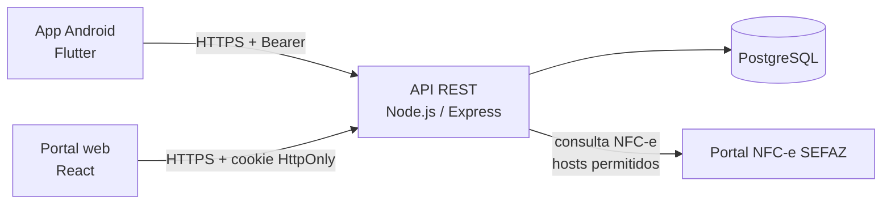
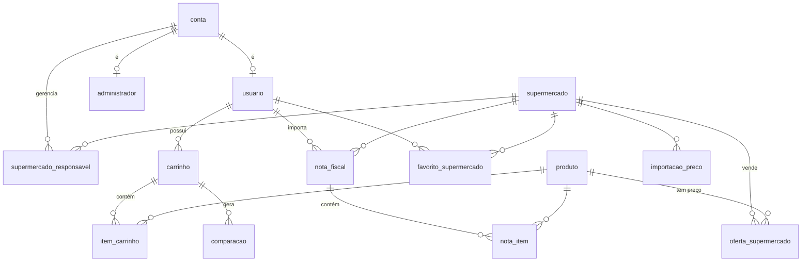

# EconoWay — Segunda entrega: prova de conceito

Projeto Integrador — Análise e Desenvolvimento de Sistemas — Senac — 2026.

Este documento reúne o que a segunda entrega pede: definição da PoC, ambiente, frontend, backend, arquitetura, modelo de dados, instruções de execução, testes e limitações. Os detalhes técnicos ficam nos documentos de `docs/` indicados em cada seção.

## 1. Objetivo da PoC

Demonstrar a funcionalidade central do EconoWay: **comparar a mesma cesta de compras em supermercados diferentes e indicar a opção mais econômica**, com dados vindos de um banco real e regras aplicadas pela API.

Fluxo demonstrado:

```text
cadastro/login → busca de produtos → carrinho com quantidades → seleção de supermercados
→ comparação → opção mais econômica e economia estimada → salvar → histórico
```

Casos alternativos tratados:

| Situação | Comportamento |
|---|---|
| Carrinho vazio | A API recusa a comparação (HTTP 400) e o app mostra a tela de carrinho vazio, sem opção de comparar |
| Produto sem preço em um mercado | O item aparece em `faltando` para aquele mercado |
| Cesta parcial | O mercado com cesta incompleta não é eleito como melhor opção, mesmo que o total seja menor |
| Nenhum mercado com cesta completa | A comparação pode ser vista, mas não é salva (HTTP 409) |
| Falha de comunicação | O app mostra mensagem compreensível e permite tentar novamente |
| Sessão expirada ou conta bloqueada | A API responde 401; o app apaga a sessão local, mostra a mensagem e o próximo acesso exige novo login |
| Usuário comum em recurso administrativo | A API responde 403 |

## 2. Revisão da proposta anterior

A primeira entrega previa login, geolocalização, leitura de código de barras e notificações. Para a PoC, o escopo foi concentrado no que comprova o valor do produto (a comparação da cesta). Ficaram fora da PoC: geolocalização, notificações, cashback e integração com parceiros. As decisões estão registradas em `docs/decisions/` (ADR-001 a ADR-012) e o escopo em [`docs/product/alpha-scope.md`](../product/alpha-scope.md).

Ajustes em relação ao modelo da entrega anterior:

- o banco passou de MySQL para **PostgreSQL**;
- o preço deixou de ficar no produto e passou para `oferta_supermercado`, com data de atualização e preço de fidelidade;
- o carrinho passou a ser persistido por usuário;
- a comparação salva um retrato do resultado (`lista_precos_concorrentes` em JSON) para o histórico não mudar quando os preços mudarem;
- supermercados e administradores usam o portal web; o consumidor usa o aplicativo Android.

## 3. Tecnologias

| Camada | Tecnologia |
|---|---|
| Aplicativo | Flutter / Dart (Android) |
| Portal web | React, TypeScript, Vite, Tailwind CSS |
| API | Node.js, Express 5, TypeScript |
| Banco | PostgreSQL 17 |
| Ambiente local | Contêineres com Compose (`compose.yaml`) |
| Qualidade | `node:test`, `flutter test`, ESLint, `flutter analyze`, GitHub Actions (CI e CodeQL) |

A justificativa das escolhas está em `docs/Análise e Prática da seleção de tecnologias.pdf` e na ADR-011.

## 4. Arquitetura



A API é um monólito modular: `routes → controllers → services → domain`, com regras de negócio puras em `node_backend/src/domain/` (testáveis sem banco). Detalhes em [`docs/architecture/container-architecture.md`](../architecture/container-architecture.md), [`mobile-architecture.md`](../architecture/mobile-architecture.md) e [`web-architecture.md`](../architecture/web-architecture.md). Contrato da API: [`docs/api/openapi.yaml`](../api/openapi.yaml).

Controles de segurança presentes: JWT com segredo obrigatório, emissor e audiência; revalidação do status da conta a cada requisição (cache de 30 s); perfis `USUARIO`, `SUPERMERCADO` e `ADMIN`; cookie HttpOnly e verificação de origem no portal; limite global de requisições e limites por rota; SQL parametrizado; política contra SSRF na leitura de NFC-e; token no armazenamento seguro do Android.

## 5. Modelo de dados

Tabelas principais (schema aplicado pelas migrations `node_backend/database/migrations/001` a `005`):



| Tabela | Papel |
|---|---|
| `conta` | Login, perfil (`tipo_conta`) e status; base da herança |
| `usuario`, `administrador` | Dados específicos de cada tipo de conta |
| `supermercado`, `supermercado_responsavel` | Cadastro do mercado e vínculo com a conta que o opera |
| `produto` | Catálogo único, identificado pelo código de barras |
| `oferta_supermercado` | Preço atual de um produto em um mercado, com origem e data |
| `carrinho`, `item_carrinho` | Cesta persistida do consumidor |
| `comparacao` | Resultado salvo, com totais por mercado e economia potencial |
| `nota_fiscal`, `nota_item` | Compras importadas por NFC-e |
| `importacao_preco`, `importacao_preco_erro` | Lotes de preços enviados pelo portal do supermercado |
| `auditoria` | Ações administrativas |

Descrição completa: [`docs/database/target-schema.md`](../database/target-schema.md).

**Cálculo da economia.** Apenas mercados com a cesta completa entram no ranking. A melhor opção é o menor total entre eles. A economia estimada é a diferença entre a média dos até três mercados completos mais caros e o melhor total ([`docs/product/comparison-strategy.md`](../product/comparison-strategy.md)). Com um único mercado completo, a economia é zero.

## 6. Ambiente de desenvolvimento

| Item | Versão usada na validação |
|---|---|
| Node.js | 24 (CI usa 22) |
| Flutter | canal stable, Dart 3 |
| PostgreSQL | 17 (contêiner `postgres:17-alpine`) |
| Contêineres | Compose (`compose.yaml`) |

Variáveis locais ficam em `.env.compose` (copiado de `.env.compose.example`, não versionado). O banco local é descartável; as migrations e a carga de demonstração rodam na subida da API.

## 7. Organização do frontend

**Aplicativo (`econoway_app/lib`)**

- `screens/`: login, cadastro, recuperação de senha, home, produtos, carrinho, supermercados, comparação, compartilhamento do resultado, histórico de comparações, histórico de compras, preços por mercado, perfil e leitura de NFC-e;
- `controller/`: estado do carrinho e da comparação;
- `services/` e `core/network/api_client.dart`: chamadas à API e tratamento de erros;
- `core/storage/secure_session_storage.dart`: sessão no armazenamento seguro;
- `theme/app_theme.dart`: cores e tipografia do EconoWay.

**Portal web (`web_frontend/src`)**: página institucional, login, portal do supermercado (produtos, preços, importação) e portal administrativo (resumo, usuários, supermercados, auditoria), com acesso por perfil.

## 8. Organização do backend

`node_backend/src`:

- `routes/`: definição das rotas, autenticação, perfil exigido e limites;
- `controllers/`: validação da entrada e códigos HTTP;
- `services/`: consultas SQL e transações;
- `domain/`: regras puras (carrinho, comparação, importação de preços, documentos, progresso, histórico, consultas seguras) com testes;
- `security/`: política de URLs de NFC-e;
- `middleware/`: autenticação, cabeçalhos, CSRF e limites.

Principais endpoints da PoC:

| Método | Rota | Uso |
|---|---|---|
| POST | `/api/auth/cadastro`, `/api/auth/login` | Conta e sessão |
| GET | `/api/produtos?busca=` | Busca de produtos |
| GET/PUT/DELETE | `/api/carrinho` | Carrinho persistido |
| GET | `/api/supermercados`, `/api/supermercados/favoritos` | Seleção de mercados |
| POST | `/api/comparacao` (`salvar: true` para salvar) | Comparação da cesta |
| GET | `/api/comparacao/historico`, `/api/comparacao/:id` | Histórico |
| GET | `/api/historico/compras`, `/api/historico/precos/:id` | Compras importadas e preços por mercado |
| GET | `/api/progresso` | Progresso de contribuição |

## 9. Integração

O app e o portal consomem a mesma API. O app usa Bearer; o portal usa cookie HttpOnly com verificação de origem. A API é a única que acessa o banco. Em ambiente local, o emulador Android acessa a API por `10.0.2.2:3333`.

## 10. Testes e evidências

Resultados das execuções de 22/11/2026, na branch `Diego`:

| Verificação | Resultado |
|---|---|
| Backend `npm run typecheck` | sem erros |
| Backend `npm test` | 30 testes, 30 aprovados |
| Backend `npm audit --audit-level=high` | 0 vulnerabilidades |
| Web `npm run lint` e `npm run build` | sem erros |
| Web `npm audit --audit-level=high` | 0 vulnerabilidades |
| `dart format --set-exit-if-changed` | nenhum arquivo fora do padrão |
| `flutter analyze` | sem problemas |
| `flutter test` | 21 testes, 21 aprovados |
| Stack local (banco, API, portal) | banco saudável, `/api/ready` respondendo, portal HTTP 200 |
| Teste ponta a ponta da API (fluxo da PoC e casos alternativos) | 21 verificações, 21 aprovadas |
| Cesta parcial | mercado incompleto mais barato não foi eleito; item faltante identificado |
| Conta bloqueada pelo administrador | token ainda válido passou a receber 401; novo login recebe 403 |
| Histórico de compras de outro usuário | 404 (sem acesso a dados de terceiros) |

O teste ponta a ponta cobre cadastro, cadastro duplicado, senha incorreta, login, token adulterado, acesso sem token, busca, mercados, carrinho vazio, carrinho persistido, comparação, salvar, histórico, detalhe, identificador inválido e permissões de usuário comum e administrador.

## 11. Como executar o aplicativo

```bash
cd econoway_app
flutter pub get
flutter run --dart-define=API_BASE_URL=http://10.0.2.2:3333/api   # emulador
flutter build apk --debug                                          # gera build/app/outputs/flutter-apk/app-debug.apk
```

Em aparelho físico, siga [`docs/operations/android-physical-device-development.md`](../operations/android-physical-device-development.md).

## 12. Como executar o backend e o portal web

```bash
cp .env.compose.example .env.compose   # preencher senhas e segredo locais
docker compose --env-file .env.compose up --build -d
```

O mesmo arquivo funciona com qualquer cliente compatível com Compose. Após a subida:

- API: `http://localhost:3333/api/ready`
- Portal: `http://localhost:5173`
- Contas de demonstração: e-mails e senhas definidos em `.env.compose` (`DEMO_*`).

Execução sem contêineres e detalhes: [`docs/operations/local-development.md`](../operations/local-development.md) e [`docs/operations/alpha-runbook.md`](../operations/alpha-runbook.md).

## 13. Limitações e pendências

- A carga de demonstração tem 2 mercados e 2 produtos; os números exibidos são de teste, não preços reais.
- A recuperação de senha ainda não envia e-mail (a API responde 501 e o app informa isso).
- O compartilhamento do resultado copia o texto para a área de transferência; não há envio direto para outros apps.
- Não existe histórico de variação de preço ao longo do tempo; a tela de preços mostra os preços atuais e as compras do próprio usuário.
- O banco Neon compartilhado não recebeu as migrations da PoC; antes disso o schema real precisa ser comparado ([`docs/database/current-schema.md`](../database/current-schema.md)).
- A edição de produtos pelo administrador (issue #34) está em desenvolvimento em outra branch e ainda precisa ser adaptada à arquitetura atual antes da integração.
- Os testes no aplicativo foram automatizados (unidade e widget); a validação manual em aparelho depende de dispositivo disponível no momento da gravação.

## 14. Vídeo demonstrativo (até 1 minuto)

Roteiro sugerido, gravado a partir da aplicação real com a stack local:

| Tempo | Cena |
|---|---|
| 0–6 s | Tela inicial do EconoWay e objetivo em uma frase |
| 6–14 s | Login com a conta de demonstração |
| 14–24 s | Busca de produtos e ajuste de quantidades |
| 24–30 s | Carrinho |
| 30–44 s | Seleção dos mercados e comparação: melhor opção, totais e itens faltantes |
| 44–52 s | Salvar a comparação |
| 52–60 s | Histórico com a comparação salva |
